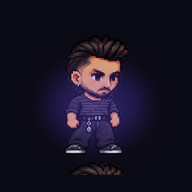

# 🎮 Shadow Runner: Pixel Adventure

> یک بازی پلتفرمر HTML5 با موتور Phaser 3 — قابل اجرا در مرورگر و قابل بسته‌بندی به APK اندروید.

<p align="center">
  
</p>

این پروژه شامل بازی کاملِ پلتفرمری به نام **Shadow Runner** است که با استفاده از Phaser 3 و HTML5 Canvas ساخته شده و با سیستم Capacitor به‌عنوان اپلیکیشن Android بسته‌بندی می‌شود. کاراکتر اصلی مردی با موی مشکی، ریش کوتاه، گوشواره و لباس راه‌راه است که در دنیایی پیکسلی با سکه‌ها، دشمنان و دروازه‌های خروج سفر می‌کند.

## ✨ ویژگی‌ها

- **موتور بازی**: Phaser 3.80 (WebGL/Web Audio)، رزولوشن ۱۲۸۰×۷۲۰، پیکسلت آرت با smoothing خاموش.
- **کاراکتر اصلی**: ۴۰ فریم انیمیشن (idle / walk / run / jump / fall / crouch / death) که از فریم‌های جداگانهٔ hero استفاده می‌کند.
- **دشمن‌ها**: ۴ نوع (walker / shell-crawler / flying-shadow / shadow-hunter) با انیمیشن مستقل.
- **مکانیک پلتفرمر**: پرش متغیر، Coyote time، Jump buffer، شتاب/اصطکاک، کنترل هوایی، Shadow Dash (با cooldown).
- **سطح اول "درهٔ سبز"**: سکه، دشمن walker، پرش روی سکوها، چک‌پوینت، دروازهٔ خروج، پارالاکس پس‌زمینه.
- **کنترل‌های لمسی**: دکمه‌های چپ/راست/JUMP/DASH/PAUSE که هم‌زمان مولتی‌تاچ کار می‌کنند.
- **HUD**: جان، سکه، امتیاز، نام مرحله، نوار انرژی سایه، دکمهٔ توقف.
- **منو و ذخیره‌سازی**: شروع جدید، ادامه، انتخاب مرحله، راهنما، تنظیمات، بی‌صدا — همگی با LocalStorage.
- **PWA**: نصب روی صفحهٔ خانهٔ Android/iOS از طریق مرورگر؛ آفلاین با Service Worker.
- **APK اندروید**: با Capacitor 6 قابل بسته‌بندی به‌صورت APK بیلد گرفته می‌شود.

## 📁 ساختار پروژه

```
shadow-runner/
├── index.html              # صفحهٔ اصلی بازی
├── style.css               # استایل رابط کاربری
├── manifest.json           # PWA manifest
├── sw.js                   # Service Worker
├── capacitor.config.json   # تنظیمات Capacitor برای APK اندروید
├── package.json            # اسکریپت‌های build
├── README.md               # این فایل
├── README_FA.md            # راهنمای فارسی
├── LICENSE                 # MIT
├── vendor/
│   └── phaser.min.js       # Phaser 3.80 (لوکال، آفلاین)
├── assets/
│   ├── backgrounds/        # پارالاکس درهٔ سبز
│   ├── characters/         # اطلس‌ها + ۴۰ فریم جداگانهٔ هیرو
│   ├── enemies/            # اطلس دشمن‌ها + ۱۶ فریم جداگانه
│   ├── tiles/              # اطلس تایل‌ها + ۱۶ تایل جداگانه
│   ├── collectibles/       # اطلس آیتم‌ها + ۲۳ اسپرایت جداگانه (استخراج شده)
│   └── icons/              # آیکون‌های ۴۸..۵۱۲ PWA/Android
├── src/
│   ├── main.js             # نقطهٔ ورودی
│   ├── scenes/             # Boot, Menu, Game, UI
│   ├── entities/           # Hero, Enemy, Coin, Checkpoint, Exit
│   ├── systems/            # Controls, Audio, Storage
│   └── levels/             # levels.js (Level 1: Green Valley)
└── scripts/                # اسکریپت‌های Python/Bash
    ├── extract_sprites.py  # استخراج اسپریت‌ها از اطلس
    ├── generate_icons.py   # ساخت آیکون‌های PWA/Android
    ├── build_android.sh    # بیلد APK با Capacitor + Gradle
    ├── sync_android.sh     # همگام‌سازی وب با پروژهٔ Android
    └── open_android.sh     # باز کردن پروژه در Android Studio
```

## 🚀 اجرا

### روش ۱: مرورگر (ساده‌ترین)

کافی است یک وب‌سرور ساده روی پوشهٔ پروژه اجرا کنید:

```bash
cd shadow-runner
python3 -m http.server 7777
# باز کنید: http://localhost:7777/index.html
```

> ⚠️ چون بازی از ES Modules استفاده می‌کند، اجرا با `file://` کار نمی‌کند؛ حتماً از یک وب‌سرور استفاده کنید.

### روش ۲: اجرای موقت با npx

```bash
cd shadow-runner
npx serve .        # یا: npx http-server -p 7777
```

### روش ۳: نصب روی Android با PWA (بدون نیاز به بیلد)

1. سرور را روی شبکهٔ محلی اجرا کنید (مثلاً `python3 -m http.server 7777 --bind 0.0.0.0`).
2. آدرس IP کامپیوتر را در مرورگر Chrome روی گوشی باز کنید: `http://192.168.1.x:7777/`.
3. منوی Chrome → **Add to Home screen**. اپ آیکون و نمایش تمام‌صفحه می‌گیرد.
4. از آن پس بازی آفلاین کار می‌کند (Service Worker آن را کش می‌کند).

### روش ۴: ساخت APK واقعی با Capacitor

پیش‌نیازها:
- **Node.js** ۱۸ یا بالاتر
- **JDK 17** (OpenJDK یا Oracle JDK)
- **Android SDK** با build-tools ۳۴ و Platform 34

```bash
cd shadow-runner
npm install                          # نصب Capacitor
bash scripts/build_android.sh        # اضافه کردن پلتفرم + sync + gradle build
```

اگر همه‌چیز درست باشد، فایل APK در این مسیر ساخته می‌شود:

```
android/app/build/outputs/apk/debug/app-debug.apk
```

این APK را می‌توانید به‌صورت مستقیم روی گوشی کپی و نصب کنید (فعال‌سازی "Install unknown apps" لازم است).

## 🎯 کنترل‌ها

### دسکتاپ

| کلید | عملکرد |
|---|---|
| `A` / `D` یا `←` / `→` | حرکت چپ/راست |
| `W` / `Space` / `↑` | پرش |
| `Shift` | دویدن |
| `S` / `↓` | نشستن |
| `E` | Shadow Dash (نیازمند ۲۵% انرژی سایه) |
| `Esc` یا `P` | توقف موقت |
| `R` | شروع مجدد مرحله |

### موبایل

دکمه‌های لمسی روی صفحه نمایش داده می‌شوند:
- **◀ / ▶** برای حرکت
- **JUMP** برای پرش
- **DASH** برای Shadow Dash
- **II** برای توقف موقت

> 💡 گوشی را به حالت افقی (Landscape) بچرخانید؛ در حالت پرتره یک پیام راهنما نمایش داده می‌شود.

## 🎨 سفارشی‌سازی

### افزودن مرحلهٔ جدید

فایل `src/levels/levels.js` را باز کنید و یک ورودی جدید به آرایهٔ `LEVELS` اضافه کنید. هر مرحله با کاراکترهای متنی تعریف می‌شود:

| کاراکتر | معنی |
|---|---|
| `.` | خالی |
| `#` | چمن (قابل لمس) |
| `D` | خاک |
| `B` | آجر |
| `Q` | بلوک پرسشی |
| `P` | لوله |
| `S` | سکو سنگی |
| `C` | سکه |
| `A` | انرژی سایه |
| `E` | دشمن walker |
| `F` | دشمن پرنده |
| `H` | چک‌پوینت |
| `X` | دروازهٔ خروج |
| `@` | محل شروع هیرو |

### تنظیم فیزیک

ثابت‌های فیزیک در `src/entities/Hero.js` قابل تنظیم‌اند:

```js
this.WALK_SPEED = 220;        // px/s
this.SPRINT_SPEED = 340;       // px/s
this.JUMP_VELOCITY = -470;     // px/s
this.ACCEL_GROUND = 2400;      // px/s²
// ...
```

### تنظیمات صدا

آهنگ‌ها و افکت‌های صوتی در `src/systems/Audio.js` به‌صورت رویه‌ای با Web Audio ساخته می‌شوند — هیچ فایل صوتی خارجی نیاز نیست.

## 🛠️ اسکریپت‌های مفید

| اسکریپت | کاربرد |
|---|---|
| `python3 scripts/extract_sprites.py` | استخراج اسپریت‌های جداگانه از اطلس collectibles |
| `python3 scripts/generate_icons.py` | ساخت آیکون‌های PWA در اندازه‌های ۴۸..۵۱۲ |
| `bash scripts/build_android.sh` | بیلد APK اندروید |
| `bash scripts/sync_android.sh` | همگام‌سازی فایل‌های وب با پروژهٔ Android |

## 📦 انتشار

1. **PWA**: روی هر هاست استاتیک (GitHub Pages، Netlify، Vercel) قرار دهید و آدرس آن را در گوشی باز کنید و "Add to Home screen" را بزنید.
2. **APK**: با `bash scripts/build_android.sh` بیلد بگیرید و فایل `app-debug.apk` را در Google Play یا مستقیماً روی گوشی توزیع کنید.
3. **Play Store**: برای انتشار در Play Store، یک حساب توسعه‌دهندهٔ گوگل پلی ($25 یکبار) لازم دارید و باید یک release-signed APK بسازید. راهنمای رسمی: <https://developer.android.com/studio/publish>

## 📝 وضعیت فعلی

- ✅ Level 1 (Green Valley) به‌طور کامل playable
- ✅ هیرو با تمام انیمیشن‌ها و فیزیک کامل
- ✅ ۴ نوع دشمن با انیمیشن (walker فعال در Level 1؛ بقیه به‌سادگی اضافه می‌شوند)
- ✅ سکه، چک‌پوینت، دروازهٔ خروج
- ✅ Shadow Dash با cooldown و نوار انرژی
- ✅ کنترل لمسی و کیبورد
- ✅ HUD، منو، تنظیمات، توقف، گیم‌اور
- ✅ PWA + Service Worker
- ✅ Capacitor config برای APK اندروید
- ⏳ Level 2 تا ۵ (قالب آماده در `levels.js` برای افزودن سریع)
- ⏳ بادی فایت سه‌فازی در Level ۵
- ⏳ لول ادیتور

## 📜 مجوز

MIT — استفاده، کپی، تغییر و انتشار آزاد.

## 🙏鸣谢

- هنر پیکسلی از بستهٔ دارایی‌های ارجاعی Shadow Runner.
- موتور بازی: [Phaser 3](https://phaser.io).
- بسته‌بندی APK: [Capacitor](https://capacitorjs.com).
